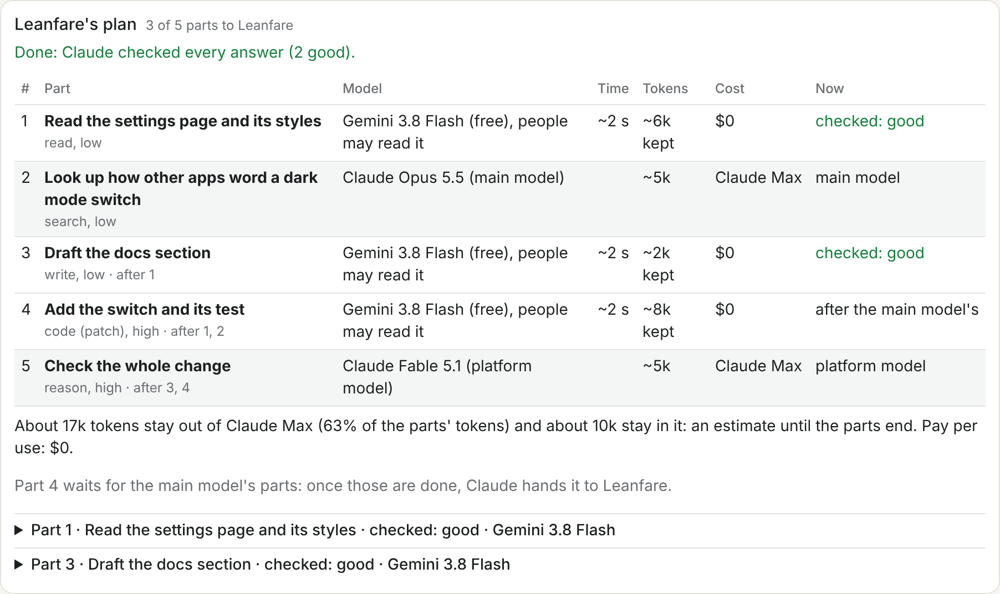
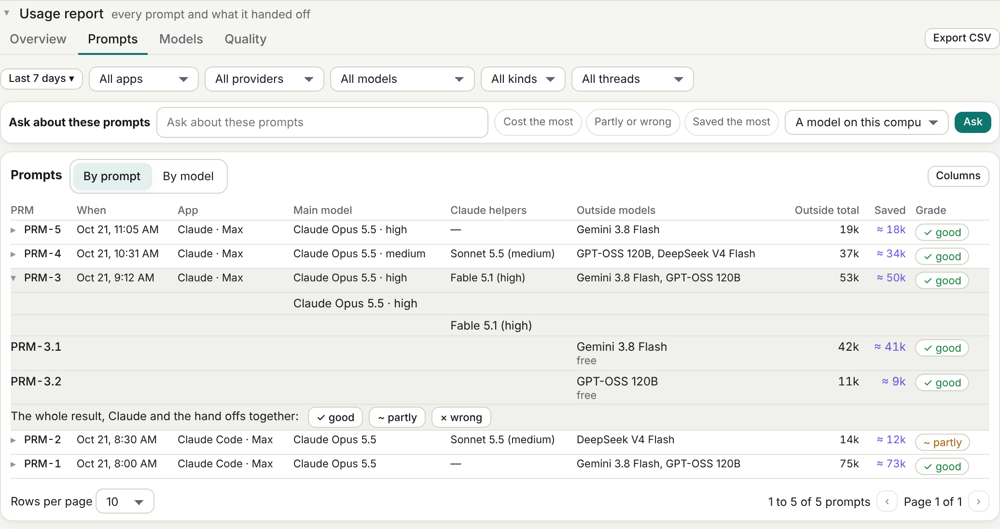
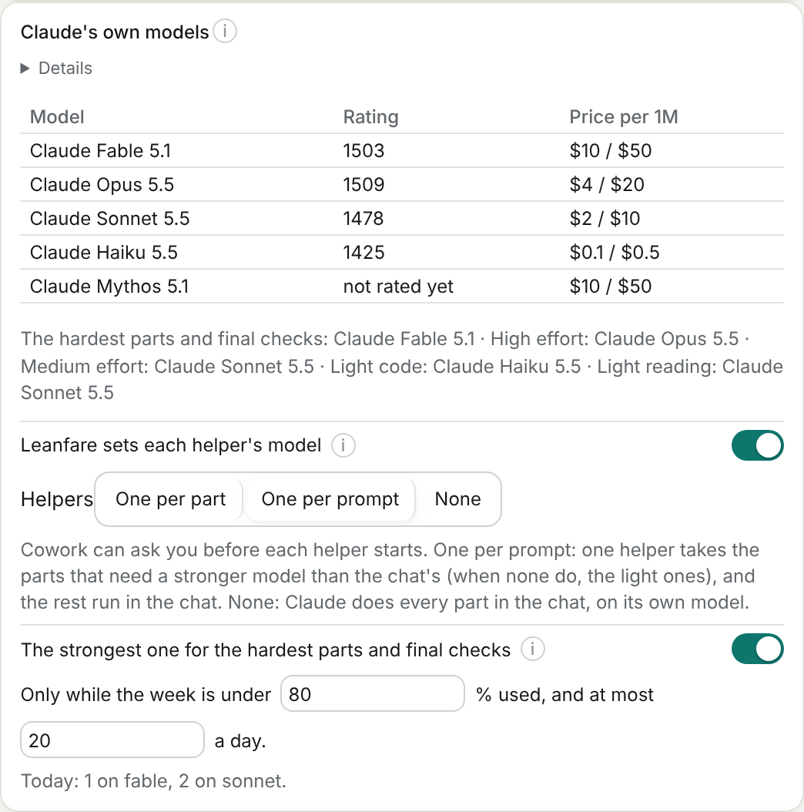

# Leanfare

[](https://github.com/pouriaetab/leanfare/releases/latest) [](https://github.com/pouriaetab/leanfare/actions/workflows/ci.yml) [](LICENSE)

Leanfare makes your Claude plan last longer. Claude keeps the hard parts of a task and hands the simple ones, like reading files, searching and drafting, to free or cheaper models. You keep working in Claude as before.



> Leanfare is early and changes every week. If something breaks, [report a bug](https://github.com/pouriaetab/leanfare/issues/new?template=bug_report.yml); Settings, **Report a problem**, fills in your version. Questions and ideas go to [Discussions](https://github.com/pouriaetab/leanfare/discussions).

## How it works

1. You ask Claude for something, in Claude Desktop, Cowork or Claude Code.
2. Claude asks Leanfare for a plan. Leanfare splits the task into parts and picks a model for each: free or cheap models for reading and drafting, Claude's own models for the hard parts.
3. Leanfare sends its parts to those models and hands the answers back. Claude does the rest, checks every answer, and answers you.
4. Leanfare's report shows what each prompt used and what it saved.

## Get started

On macOS or Linux, paste this in Terminal:

```sh
curl -fsSL https://raw.githubusercontent.com/pouriaetab/leanfare/main/install.sh | sh
```

On Windows, paste this in PowerShell:

```powershell
powershell -ExecutionPolicy Bypass -c "irm https://raw.githubusercontent.com/pouriaetab/leanfare/main/install.ps1 | iex"
```

Then type `leanfare` in the same window. In the page that opens, press **Turn on Leanfare**, then restart Claude. That's all.

Leanfare needs at least one model to hand work to. It uses the API keys and Ollama models already on your computer, and Settings connects free ones with one press each: ChatGPT (a free account works), Gemini, Groq, OpenRouter, Mistral and Cloudflare.

Other ways in: the Claude Code plugin (`/plugin marketplace add pouriaetab/leanfare`, then `/plugin install leanfare@leanfare`), or a one click `.mcpb` file for Claude Desktop from the [latest release](https://github.com/pouriaetab/leanfare/releases/latest).

## What you see

**The report.** Every prompt with its main model, Claude's helpers and the outside models, and what was saved. By prompt or by model, over any days.



**Claude's own models.** Leanfare picks the Claude model for each helper Claude starts, from llmledger's ratings and prices. As the ratings stand: Fable 5.1 for the hardest parts, Opus 5.5 for high effort, Sonnet 5.5 for medium and Haiku 5.5 for light code. Cowork can ask you to approve each helper, so you choose how many a prompt starts: one per part, one per prompt, or none.



## Three settings

1. **Level**, from 1 (Off) to 5 (All it can): how much Claude hands to Leanfare first.
2. **Helpers**: one per part, one per prompt (the default), or none.
3. **Where work may go**: only this computer, or the providers you ticked.

Leanfare picks the rest for you. The [guide](docs/GUIDE.md) explains every part.

## What's inside

Leanfare is an MCP server with a small web app, both on your computer. Claude connects to it over stdio, like any MCP server. It is TypeScript on [Bun](https://bun.sh), with no runtime dependencies.

| File | What it is |
|---|---|
| `src/mcp.ts` | The MCP server and its tools |
| `src/cli.ts` | The `leanfare` command |
| `src/server.ts` | The app and its API, at http://127.0.0.1:4747 |
| `src/planner.ts` | Plans: the parts, a model for each, the runs |
| `src/delegate.ts` | Hand offs to outside models, each with a receipt |
| `src/claudeladder.ts` | Claude's own models, in order |
| `ui/` | The app's screens |

The MCP tools: `plan`, `plan_run`, `plan_status`, `plan_stop`, `delegate`, `ask`, `grade`, `level`, `report`, `spend`, `models`, `estimate`, `trial`, `local_model`, `live` and `helper`.

To build and run it from source:

```sh
git clone https://github.com/pouriaetab/leanfare.git
cd leanfare
bun install
bun test             # against fake providers; nothing leaves your computer
bun src/cli.ts       # the app
bun src/cli.ts mcp   # the MCP server, over stdio
```

## In any MCP host

Leanfare is a standard MCP server over stdio: the command is `leanfare mcp`, with no environment variables. When the Leanfare app is not running, the server starts it.

```json
{
  "mcpServers": {
    "leanfare": {
      "command": "/Users/you/.leanfare/bin/leanfare",
      "args": ["mcp"]
    }
  }
}
```

The install line puts the program in `~/.leanfare/bin/leanfare` on macOS and Linux, and in `%LOCALAPPDATA%\Leanfare\bin\leanfare.exe` on Windows. Use its full path: an app opened from the Dock or the Start menu may not see your shell's PATH. VS Code takes the same command and args in `.vscode/mcp.json`, under `servers` with `"type": "stdio"`.

**Hosts.** Leanfare is built and tested for Claude Desktop, Cowork and Claude Code. There **Turn on Leanfare** sets it up in one press, and the level, the hooks and the per-prompt report work. Other MCP hosts that run local stdio servers, such as VS Code with GitHub Copilot's agent mode, can run the same tools with the configuration above: the host's model plans with Leanfare, hands it reading and drafting, grades the answers, and the report counts those hand offs. The one-press setup, the level hooks and the main model's own token counts are for Claude's apps only, and other hosts are not tested.

**In the MCP Registry.** `io.github.pouriaetab/leanfare` lists an MCPB bundle (registry type `mcpb`, transport stdio) for each computer Claude Desktop runs on: macOS on Apple silicon, macOS on Intel, and Windows. Each comes from the release with its SHA-256, holds the compiled program, and starts `leanfare mcp`. For Linux, or a host that does not take MCPB bundles, use the install line and the configuration above.

## Privacy

Leanfare reads usage numbers, never your words, unless you choose in Settings to keep a hand off's words on your computer to read later. Your keys stay on your computer, and requests go from your computer straight to the AI company you use. No telemetry. The [guide](docs/GUIDE.md#privacy) has the details.

## Update, stop or take it out

1. **Update:** run the install line again. Leanfare says when a new version is out.
2. **Stop:** type `leanfare stop`.
3. **Off for a while:** the switch at the top of the app.
4. **Take it out of an app:** Settings, In your apps, then **Remove** next to the app.

## Data and credits

Prices come from [llmledger](https://github.com/pouriaetab/llmledger) (MIT), built from LiteLLM's public price list (MIT). Quality ratings come from the [Arena leaderboard](https://huggingface.co/datasets/lmarena-ai/leaderboard-dataset) (CC BY 4.0). The [guide](docs/GUIDE.md#data-and-credits) lists the rest. Leanfare is not affiliated with any AI provider.

## Licence

MIT
