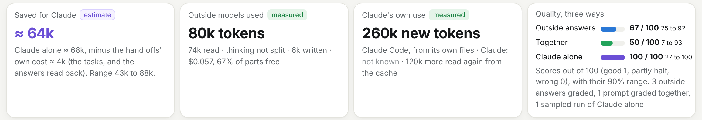

# Leanfare

[](https://github.com/pouriaetab/leanfare/releases/latest) [](https://github.com/pouriaetab/leanfare/actions/workflows/ci.yml) [](LICENSE)

Leanfare makes the AI apps you already use cost less. It works inside them and hands simple work, like reading files and drafting, to cheaper or free models. You keep working as before.

It works with Claude Desktop, Cowork, Claude Code, Cursor, Codex, Gemini CLI, Windsurf, VS Code and LM Studio.



> Leanfare is early and changes every week. If something breaks, [report a bug](https://github.com/pouriaetab/leanfare/issues/new?template=bug_report.yml); Settings, **Report a problem**, fills in your version. Questions and ideas go to [Discussions](https://github.com/pouriaetab/leanfare/discussions).

## Get started

1. **Install it.** On macOS or Linux, paste this in Terminal:

   ```sh
   curl -fsSL https://raw.githubusercontent.com/pouriaetab/leanfare/main/install.sh | sh
   ```

   On Windows, paste this in PowerShell:

   ```powershell
   powershell -ExecutionPolicy Bypass -c "irm https://raw.githubusercontent.com/pouriaetab/leanfare/main/install.ps1 | iex"
   ```

2. **Open it.** Type `leanfare`. The app opens in your browser.
3. **Press Turn on Leanfare.** Leanfare finds the AI apps on your computer and adds itself to each one. Then do the one step it shows for each app (most need a restart).

That's all. Keep working in your apps: Leanfare steps in on reading and drafting.

### No model yet?

Leanfare needs a model to hand work to. It uses an API key your computer already has (like `OPENAI_API_KEY`), or Ollama's free models, when it finds them. When it finds none, Set up offers the quickest ways:

- **Connect OpenRouter.** Sign in on OpenRouter's page. It has free models, and there is nothing to copy.
- **A free Google key.** Make one at [Google AI Studio](https://aistudio.google.com/apikey), press **Add a key** and paste it. On Google's free plan, people at Google may read your messages, and Google uses them to improve its products: Leanfare marks it, and keeps private work on your computer when an app asks.
- **Ollama.** Install [Ollama](https://ollama.com/download) for free models on your own computer, then press **Look again**. Set up then offers the best free model that fits your computer and downloads it when you say yes.

## The app

- **The switch at the top**, In your apps, turns Leanfare off and on in all your apps at once. Off means your apps do all the work themselves.
- **Chat** talks to any model, and each answer says which model wrote it and what it cost. **Plan** splits a task across models. **Savings** opens with a report of what Leanfare did for your apps, over any span and prompt by prompt: both sides of each hand off (what the outside models used, measured, and what your app would have used alone, an estimate), the saving, each model's speed and failures, and quality three ways. Then what Leanfare saved and what you spent. **Settings** has the rest: models and keys, your apps, your plans, a monthly budget. Leanfare picks all of it for you. Change it only if you want to.
- **Inside Claude:** ask for Leanfare's report, and Claude Desktop and Cowork show it as a card in the chat. A plan shows there as a table, with each part's model, your app's own included.
- **Fair grades:** a sample of the answers is checked blind, by a model of another company when one can take it, and now and then compared with the best model you ticked.
- **Picks that learn:** your grades move each model's rating for each kind of work, its time is learned from its own answers, and a model that keeps failing rests while Auto picks others.
- **Your plan's mode and your rules:** as your Claude plan runs low, Leanfare pushes more work out of it (Settings shows the mode), and Settings, Jobs, says where each kind of job goes, with a cap for paid work. Grades show as a score out of 100 with its range.
- **Your own models:** Settings, Local models says where they are and tests one on your computer. One that passes takes reading work first, for free. **Where Leanfare may send work** turns each platform off or on, with what is left before its nearest limit.
- The [guide](https://github.com/pouriaetab/leanfare/blob/main/docs/GUIDE.md) explains each part.

## Privacy

Leanfare reads usage numbers, never your words. Your keys stay on your computer, and requests go from your computer straight to the AI company you use. No telemetry. The [guide](https://github.com/pouriaetab/leanfare/blob/main/docs/GUIDE.md#privacy) has the details.

## Update, stop or take it out

- **Update:** run the install line again. Leanfare says when a new version is out.
- **Stop:** type `leanfare stop`.
- **Turn it off for a while:** the switch at the top, In your apps.
- **Take it out of an app:** in Leanfare, Settings, In your apps, then **Remove** next to the app.

## Data and credits

Prices come from [llmledger](https://github.com/pouriaetab/llmledger) (MIT), built from LiteLLM's public price list (MIT). Quality ratings come from the [Arena leaderboard](https://huggingface.co/datasets/lmarena-ai/leaderboard-dataset) (CC BY 4.0). The [guide](https://github.com/pouriaetab/leanfare/blob/main/docs/GUIDE.md#data-and-credits) lists the rest. Leanfare is not affiliated with any AI provider.

## Licence

MIT
